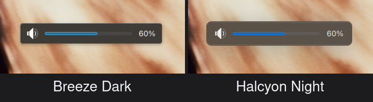
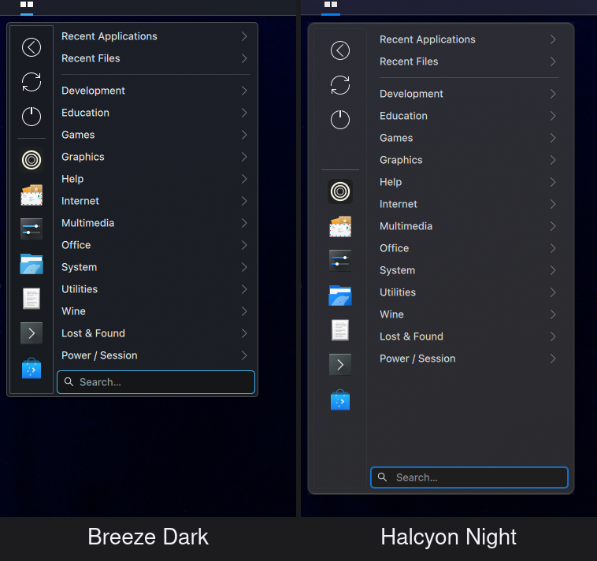

# Halcyon

A macOS 27-inspired theme for KDE Plasma 6. Day and night variants, traffic-light buttons, glass panels.

> **Alpha.** Expect rough edges. Bug reports welcome.

## Screenshots

Breeze (KDE's default) on the left, Halcyon Night on the right.

**The desktop**

**Notification**

**Volume overlay**

**Application launcher**

## What you get

Two global themes, **Halcyon Night** and **Halcyon Day**. They change window decorations, panels, popups, colours, buttons, sliders and icons. Cursor, fonts and wallpaper stay as they are.

## Install

Needs KDE Plasma 6. No root needed.

1. Optional: install `papirus-icon-theme`. Halcyon uses it if found. Run the installer with `--no-icons` to keep your own icons.
2. In the folder with `halcyon.zip`, run:

       unzip halcyon.zip && cd halcyon
       ./install.sh

3. Open **System Settings > Colors & Themes > Global Theme** and pick **Halcyon Night** or **Halcyon Day**.

Not updating? Switch themes and back, or log out and in. Re-running `./install.sh` is safe.

### The application style (optional)

The installer also builds the button and slider style. It needs Qt 6.11+, KDE Frameworks 6.30+ and build tools. If they're missing, everything else still installs. Install the tools, run `./install.sh` again, then log out and in.

Build tools for your distro

    # Arch / Manjaro
    sudo pacman -S --needed base-devel cmake extra-cmake-modules qt6-base qt6-declarative kcoreaddons kcolorscheme kconfig \
        kguiaddons kiconthemes kwindowsystem frameworkintegration

    # Fedora
    sudo dnf install cmake gcc-c++ extra-cmake-modules qt6-qtbase-devel qt6-qtdeclarative-devel kf6-kcoreaddons-devel \
        kf6-kcolorscheme-devel kf6-kconfig-devel kf6-kguiaddons-devel kf6-kiconthemes-devel kf6-kwindowsystem-devel \
        kf6-frameworkintegration-devel

    # Debian / Ubuntu / KDE neon
    sudo apt install cmake g++ extra-cmake-modules qt6-base-dev qt6-declarative-dev libkf6coreaddons-dev libkf6colorscheme-dev \
        libkf6config-dev libkf6guiaddons-dev libkf6iconthemes-dev libkf6windowsystem-dev libkf6style-dev

Package names vary. If the build reports a missing package, install it and run `./install.sh` again.

## Tips

- **Panel transparency:** panel Edit Mode > Opacity. Translucent needs KWin's **Blur** effect.
- **Blurred titlebars:** System Settings > Window Decorations > `halcyon-night-blur` or `halcyon-day-blur`.

## Known issues

- A small light wedge can appear outside rounded corners. It comes from KWin's blur effect. Stock Breeze does it too.

## Uninstall

Switch to another global theme first, then:

    rm -rf ~/.config/plasma-workspace/env/halcyon.sh ~/.local/lib*/qt6/plugins/styles/halcyonglass6.so \
           ~/.local/share/kstyle/themes/halcyonglass.themerc ~/.local/share/aurorae/themes/halcyon-* \
           ~/.local/share/plasma/desktoptheme/halcyon-glass-* ~/.local/share/plasma/look-and-feel/org.jjbytex.halcyon.* \
           ~/.local/share/color-schemes/Halcyon*.colors

## Credits and license

Independent project, not affiliated with Apple or KDE. No Apple code, fonts, icons or wallpapers included.

- Window decorations are based on **Summaculate** by doncsugar (GPL-3.0).
- The application style is a fork of **KDE Breeze** (GPL-2.0-or-later).
- Papirus icons are separate and not included.

Released under GPL-3.0-or-later. See `LICENSE`.
