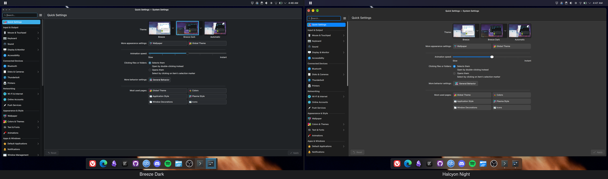
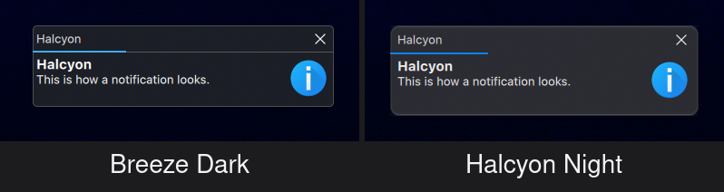

# Halcyon

A KDE Plasma 6 theme inspired by macOS 27, with day and night variants, round traffic-light window buttons on the left, and soft glass panels.

> **Alpha.** Halcyon is under active development. Expect rough edges. Bug reports are welcome.

## Screenshots

Breeze (KDE's default) on the left, Halcyon Night on the right.

**The desktop**

**Notification**

**Volume overlay**

**Application launcher**

## What you get

Two global themes, **Halcyon Night** and **Halcyon Day**, that change the window buttons and decorations, panels and popups, colours, buttons and sliders (the optional application style), and icons (Papirus, if you have it installed). Your cursor, fonts and wallpaper stay as they are.

## Install

You need KDE Plasma 6 on Linux. Nothing needs root; everything goes into your home folder.

1. Optional: install the Papirus icon theme (the package is called `papirus-icon-theme` on most distros). Halcyon uses it if it's there. To keep your own icons, run the installer with `--no-icons`.
2. In the folder with `halcyon.zip`, run:

       unzip halcyon.zip && cd halcyon
       ./install.sh

3. Open **System Settings > Colors & Themes > Global Theme** and pick **Halcyon Night** or **Halcyon Day**.

If something doesn't refresh, switch to another theme and back, or log out and in. Running `./install.sh` again is always safe.

### The application style (optional)

The installer also tries to build the button and slider style. It needs a recent system (Qt 6.11+, KDE Frameworks 6.30+) and some build tools. If they're missing, the script says so and everything else still installs. Install the tools for your distro, run `./install.sh` again, then log out and in once.

Build tools for your distro

    # Arch / Manjaro
    sudo pacman -S --needed base-devel cmake extra-cmake-modules qt6-base qt6-declarative kcoreaddons kcolorscheme kconfig \
        kguiaddons kiconthemes kwindowsystem frameworkintegration

    # Fedora
    sudo dnf install cmake gcc-c++ extra-cmake-modules qt6-qtbase-devel qt6-qtdeclarative-devel kf6-kcoreaddons-devel \
        kf6-kcolorscheme-devel kf6-kconfig-devel kf6-kguiaddons-devel kf6-kiconthemes-devel kf6-kwindowsystem-devel \
        kf6-frameworkintegration-devel

    # Debian / Ubuntu / KDE neon
    sudo apt install cmake g++ extra-cmake-modules qt6-base-dev qt6-declarative-dev libkf6coreaddons-dev libkf6colorscheme-dev \
        libkf6config-dev libkf6guiaddons-dev libkf6iconthemes-dev libkf6windowsystem-dev libkf6style-dev

Package names vary between releases. If the build names a missing package, install that one and run `./install.sh` again.

## Tips

- **Panel transparency:** right-click the panel, choose Edit Mode, then Opacity. Translucent needs KWin's **Blur** effect turned on.
- **Blurred titlebars:** pick `halcyon-night-blur` or `halcyon-day-blur` under System Settings > Window Decorations.

## Known issues

- A small light wedge can show just outside the rounded corners of some popups and windows. This comes from KWin's blur effect, and stock Breeze does it too.

## Uninstall

Switch to another global theme first, then:

    rm -rf ~/.config/plasma-workspace/env/halcyon.sh ~/.local/lib*/qt6/plugins/styles/halcyonglass6.so \
           ~/.local/share/kstyle/themes/halcyonglass.themerc ~/.local/share/aurorae/themes/halcyon-* \
           ~/.local/share/plasma/desktoptheme/halcyon-glass-* ~/.local/share/plasma/look-and-feel/org.jjbytex.halcyon.* \
           ~/.local/share/color-schemes/Halcyon*.colors

## Credits and license

Halcyon is an independent project, not affiliated with or endorsed by Apple or KDE. No Apple code, fonts, icons or wallpapers are included.

- Window decorations are based on **Summaculate** by doncsugar (GPL-3.0).
- The application style is a fork of **KDE Breeze** (GPL-2.0-or-later).
- Papirus icons are a separate project and aren't included.

Released under GPL-3.0-or-later. See `LICENSE`.
